<!-- ══════════════════════════════ HERO ══════════════════════════════ -->
<div align="center">
  
</div>

<br/>

<div align="center">

<a href="https://blog.csdn.net/qq_31762741"></a>


<br/><br/>


</div>

<!-- ══════════════════════════════ 01 ABOUT ══════════════════════════ -->
<h3>
  
  &nbsp;About Me&nbsp;<sub><sup>关于我</sup></sub>
</h3>

<table>
<tr>
<td width="50%" valign="top">

```python
class Me(Human):
    name = "花伤情犹在"
    role = "AI Dev Engineer"
    city = "Hong Kong"

    models = ["Claude", "GPT",
              "Gemini", "Grok",
              "DeepSeek", "Kimi"]
    tools  = ["Multica", "T3 Code",
              "Orca", "OpenBot",
              "OpenMaus", "Muse",
              "Cue", "Grok Bot"]

    def work(self, idea):
        # 人负责想清楚
        plan = self.think(idea)
        # Agent 负责写出来
        return Fleet(self.tools) \
            .ship(plan)
```

</td>
<td width="50%" valign="top">

<br/>

🤖&nbsp;&nbsp;**AI 开发工程师**：把大模型和 Agent 接进真实业务流程

🧠&nbsp;&nbsp;多模型协作：Claude 规划 · Codex 写码 · Gemini 审查

🛠️&nbsp;&nbsp;Agent 工程：MCP / Skill / 工作流编排 / 多 Agent 并行

⚙️&nbsp;&nbsp;落地场景：客服邮件、飞书审批、知识库问答、运维自动化

☕&nbsp;&nbsp;出身 **Java 后端**，Spring 全家桶依然是基本功

✍️&nbsp;&nbsp;活跃于 **CSDN**，把踩过的坑写成文字

<br/>

<div align="center">
  
  
</div>

</td>
</tr>
</table>


<!-- ══════════════════════════════ 02 AI ARSENAL ═════════════════════ -->
<h3>
  
  &nbsp;AI Arsenal&nbsp;<sub><sup>我的 AI 军火库</sup></sub>
</h3>

<div align="center">



<br/><br/>

<!-- ── 模型 ── -->
<table>
<tr><td colspan="6" align="center"><b>&nbsp;🧠&nbsp; Foundation Models &nbsp;·&nbsp; 大模型 &nbsp;</b></td></tr>
<tr>
<td align="center" width="110"><a href="https://claude.ai"></a><br/><sub><b>Claude</b></sub><br/><sub>Anthropic</sub></td>
<td align="center" width="110"><a href="https://chatgpt.com"></a><br/><sub><b>GPT</b></sub><br/><sub>OpenAI</sub></td>
<td align="center" width="110"><a href="https://gemini.google.com"></a><br/><sub><b>Gemini</b></sub><br/><sub>Google</sub></td>
<td align="center" width="110"><a href="https://grok.com"></a><br/><sub><b>Grok</b></sub><br/><sub>xAI</sub></td>
<td align="center" width="110"><a href="https://www.deepseek.com"></a><br/><sub><b>DeepSeek</b></sub><br/><sub>深度求索</sub></td>
<td align="center" width="110"><a href="https://www.kimi.com"></a><br/><sub><b>Kimi</b></sub><br/><sub>月之暗面</sub></td>
</tr>
</table>

<!-- ── Agent 工具 ── -->
<table>
<tr><td colspan="8" align="center"><b>&nbsp;🛸&nbsp; Agent Tooling &nbsp;·&nbsp; AI 工具 &nbsp;</b></td></tr>
<tr>
<td align="center" width="88"><a href="https://github.com/multica-ai/multica"></a><br/><sub><b>Multica</b></sub><br/><sub>人机协作</sub></td>
<td align="center" width="88"><a href="https://github.com/pingdotgg/t3code"></a><br/><sub><b>T3 Code</b></sub><br/><sub>Agent 控制台</sub></td>
<td align="center" width="88"><a href="https://github.com/stablyai/orca"></a><br/><sub><b>Orca</b></sub><br/><sub>Agent 舰队</sub></td>
<td align="center" width="88"><a href="https://github.com/nightly-labs/openbot"></a><br/><sub><b>OpenBot</b></sub><br/><sub>AI 队友</sub></td>
<td align="center" width="88"><a href="https://github.com/milind-soni/OpenMausBot"></a><br/><sub><b>OpenMaus</b></sub><br/><sub>虚拟机 Agent</sub></td>
<td align="center" width="88"><a href="https://developer.meta.com/ai/products/muse-code/"></a><br/><sub><b>Muse</b></sub><br/><sub>Meta</sub></td>
<td align="center" width="88"><a href="https://cue.im"></a><br/><sub><b>Cue</b></sub><br/><sub>Manus</sub></td>
<td align="center" width="88"><a href="https://x.ai/bot"></a><br/><sub><b>Grok Bot</b></sub><br/><sub>xAI</sub></td>
</tr>
</table>

</div>


<!-- ══════════════════════════════ 03 STACK ══════════════════════════ -->
<h3>
  
  &nbsp;Tech Stack&nbsp;<sub><sup>技术栈</sup></sub>
</h3>

<div align="center">

<b>🤖 AI Engineering</b><br/><br/>


<br/><br/>

<b>⚙️ Engineering</b><br/><br/>


</div>


<!-- ══════════════════════════════ 04 STATS ══════════════════════════ -->
<h3>
  
  &nbsp;GitHub Activity&nbsp;<sub><sup>贡献动态</sup></sub>
</h3>

<div align="center">
<br/>

</div>


<!-- ══════════════════════════════ 05 CONTACT ════════════════════════ -->
<h3>
  
  &nbsp;Get In Touch&nbsp;<sub><sup>联系我</sup></sub>
</h3>

<div align="center">

<table>
  <tr>
    <td align="center" width="180">
      <a href="https://blog.csdn.net/qq_31762741"></a>
      <br/><sub>技术博客 · 持续更新</sub>
    </td>
    <td align="center" width="180">
      <a href="https://github.com/Flowers-hurt"></a>
      <br/><sub>Issue / PR 随时来</sub>
    </td>
  </tr>
</table>

<br/>

<i>⭐&nbsp; 如果内容对你有帮助，欢迎点个 Star —— 这是对分享者最好的鼓励</i>

<br/><br/>


</div>
